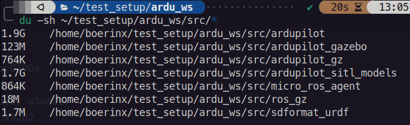
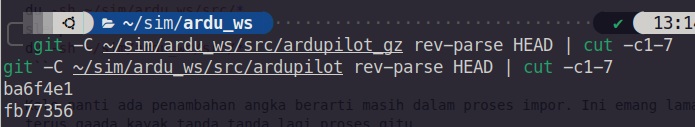
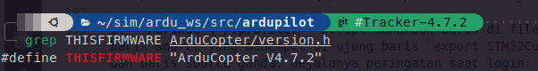
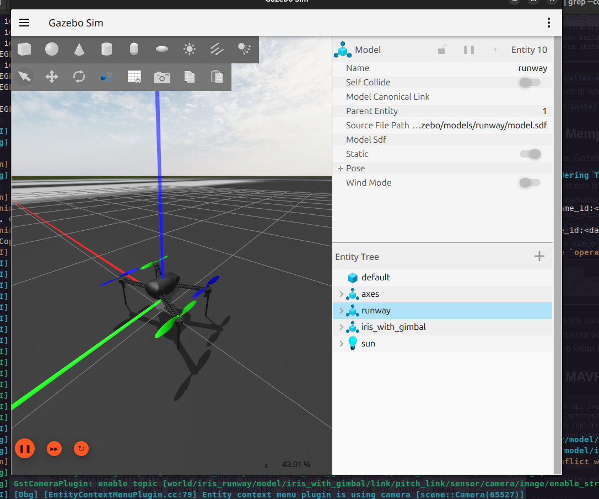
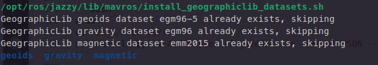
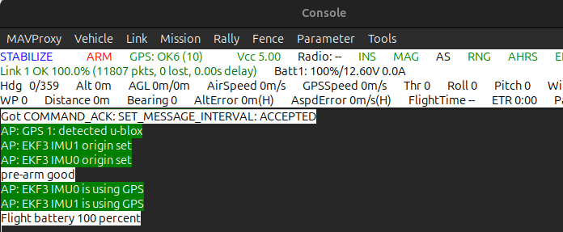
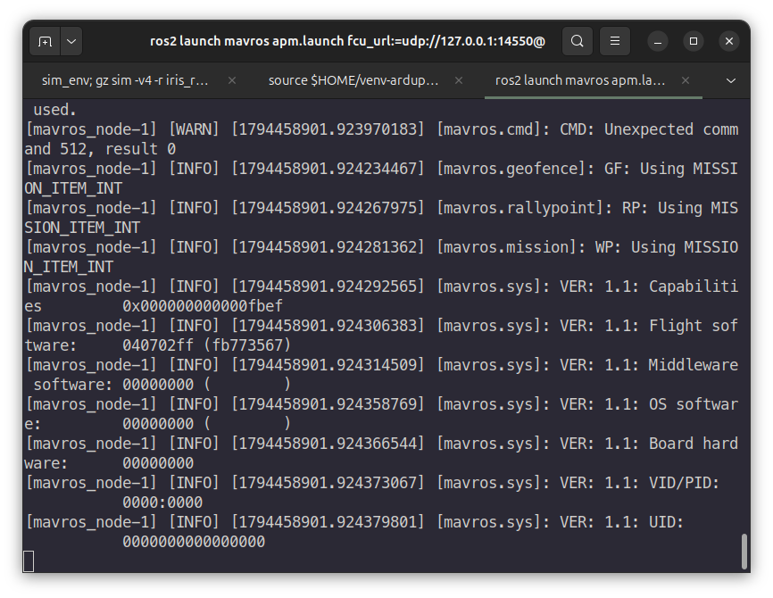
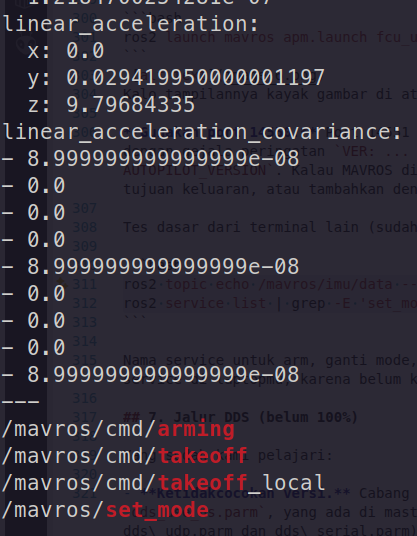

# Setup ROS 2 Jazzy + ArduPilot SITL + Gazebo Harmonic + MAVROS (Ubuntu 24.04)

Dokumen ini bisa digunakan untuk membantu kalian setup agar bisa mengikuti pelatihan Vision & Control Programmer Gamaforce 2027. Ini semua berhasil di laptopku, ada beberapa error dan sudah ku fix, jadi harapannya kalian sudah ngga nemuin error yang sama lagi. Kalo nemuin error feel free buat tanya aku yaa. Semoga membantu ges :)

## 0. Jalur Nix (flakes)

Di branch `nix`, semua dependensi (ROS 2 Jazzy, Gazebo Harmonic, MAVROS, Python ArduPilot, JDK 17, Gradle) disediakan oleh flake. Tidak perlu menjalankan `apt install` untuk paket-paket itu.

```bash
nix develop                 # masuk shell ROS 2 Jazzy + Gazebo + MAVROS + tool ArduPilot
ardu_ws_init                # buat ~/sim/ardu_ws berisi symlink sumber yang dikunci di flake.lock
ardu_models_init            # unduh SITL_Models (repo data besar, sekali, butuh internet)
ardu_build                  # colcon build --packages-up-to ardupilot_dds_tests
```

Jalankan tiga terminal terpisah di dalam `nix develop`:

```bash
gz_sim_run                  # Gazebo + iris_runway.sdf
sitl_run                    # ArduPilot SITL (gazebo-iris, JSON, MAVProxy console)
mavros_run                  # MAVROS lewat UDP 14550
```

`sim_env` menyiapkan `install/setup.*` dan `GZ_SIM_RESOURCE_PATH` untuk terminal lain. Cek tanpa menginstal atau membangun apa pun: `nix flake check --no-build` dan `nix build --dry-run .#devShells.x86_64-linux.default`.

Catatan: `SITL_Models` sengaja bukan input flake karena ukurannya, jadi diambil lewat `ardu_models_init`. Dataset GeographicLib untuk MAVROS belum dibungkus otomatis; jalankan langkah dataset jika dibutuhkan. Bagian 4-8 di bawah adalah instruksi apt lama untuk referensi.

## 1. Status ringkas

| Komponen | Status | Catatan |
| --- | --- | --- |
| ArduPilot SITL + Gazebo Harmonic (plugin ardupilot_gazebo) | Berjalan | Perlu menambah satu path ke GZ_SIM_RESOURCE_PATH (bagian 5.7) |
| ROS 2 lewat MAVROS | Berjalan | Gunakan port 14550 (bagian 6) |

## 2. Lingkungan yang diuji

- Ubuntu 24.04 (Noble), dual boot, shell zsh (kalo ngga tau apa itu zsh berarti pake bash). Cek dengan `echo $SHELL`: hasilnya berakhiran `zsh` atau `bash`
- ROS 2 Jazzy (paket ros-jazzy-desktop dan ros-jazzy-ros-gz)
- Gazebo Sim 8.15.0 (Harmonic), berasal dari paket vendor ROS (`ros-jazzy-gz-*-vendor`), bukan dari repositori OSRF
- ArduPilot Copter 4.7.2 (rilis stabil).
- MAVROS dari paket apt ros-jazzy-mavros
- Dokumentasi ArduPilot untuk ROS 2 ditulis untuk ROS 2 Humble. Jazzy bukan jalur resmi, jadi sebagian langkah perlu penyesuaian seperti di dokumen ini

## 3. Struktur folder

```
~/sim/
  ardu_ws/                 workspace colcon khusus ArduPilot
    src/                   ardupilot, ardupilot_gazebo, ardupilot_gz, micro_ros_agent, ros_gz, sdformat_urdf, dll.
    build/ install/ log/   dibuat otomatis oleh colcon (boleh dihapus lalu dibangun ulang)
    Micro-XRCE-DDS-Gen/    alat pembangun DDS (di luar src, bukan paket ROS)
    runs/                  folder kerja untuk menjalankan SITL (log, eeprom.bin tersimpan di sini)
    ros2_jazzy_pinned.repos  daftar repositori yang dikunci ke commit tertentu (dibuat di bagian 5.3)
~/venv-ardupilot/          venv Python milik ArduPilot (jangan dipindah)
```

Aturan penting: jalankan `colcon build` selalu dari `~/sim/ardu_ws`, bukan dari dalam `src`.

## 4. Prasyarat sistem

- **Disk:** sisakan minimal 15 sampai 20 GB bebas sebelum mulai (perkiraan kasar). Setup pertama gagal di tengah jalan karena disk penuh.
- **RAM:** build micro_ros_agent dan ArduPilot memakai banyak memori. Laptop sempat membeku total pada build pertama.
- **earlyoom (disarankan):** mematikan proses paling rakus saat memori hampir habis, sehingga laptop tidak membeku.

```bash
sudo apt install -y earlyoom
df -h /
free -h
```

Kalau pernah mati paksa saat build, cek filesystem dengan `sudo dmesg` (cari pesan error atau corrupt), lalu hapus hasil build setengah jadi: `rm -rf build install log` di ardu_ws.

## 5. Instalasi

### 5.1 ROS 2 Jazzy dan paket Gazebo

Ikuti panduan resmi ROS 2 Jazzy di docs.ros.org, lalu:

```bash
sudo apt install -y ros-jazzy-desktop ros-jazzy-ros-gz
gz sim --version
```

Hasil yang diharapkan: Gazebo Sim version 8.15.0. Jangan memasang libgz-sim8-dev atau paket Gazebo dari repositori OSRF di atas paket vendor ROS, karena dua sumber itu bisa bentrok.

### 5.2 Konfigurasi shell (bash/zsh)

Tujuannya: terminal baru hanya memuat ROS 2 Jazzy. Venv ArduPilot dan workspace tim dimuat hanya kalau diminta.

Di langkah ini dan beberapa langkah berikutnya, perintahnya berbeda untuk zsh dan bash. Pilih blok yang sesuai dengan hasil `echo $SHELL`.

Backup file konfigurasi, lalu cek baris ROS 2 yang sudah ada:

**zsh**

```bash
cp ~/.zshrc ~/.zshrc.bak
grep -n 'ros/jazzy' ~/.zshrc
```

**bash**

```bash
cp ~/.bashrc ~/.bashrc.bak
grep -n 'ros/jazzy' ~/.bashrc
```

Pastikan ada satu baris `source /opt/ros/jazzy/setup.zsh` (zsh) atau `source /opt/ros/jazzy/setup.bash` (bash). Kalau workspace tim di-source otomatis, ubah menjadi komentar dan buat alias. Lalu tambahkan:

**zsh**

```bash
cat >> ~/.zshrc << 'EOF'
typeset -U path PATH
export PATH="$PATH:$HOME/sim/ardu_ws/src/ardupilot/Tools/autotest"
alias ardu='source $HOME/venv-ardupilot/bin/activate'
sim_env() {
  source "$HOME/sim/ardu_ws/install/setup.zsh"
  export GZ_SIM_RESOURCE_PATH="$GZ_SIM_RESOURCE_PATH:$HOME/sim/ardu_ws/install/ardupilot_gazebo/share"
}
EOF
source ~/.zshrc
```

**bash**

```bash
cat >> ~/.bashrc << 'EOF'
export PATH="$PATH:$HOME/sim/ardu_ws/src/ardupilot/Tools/autotest"
alias ardu='source $HOME/venv-ardupilot/bin/activate'
sim_env() {
  source "$HOME/sim/ardu_ws/install/setup.bash"
  export GZ_SIM_RESOURCE_PATH="$GZ_SIM_RESOURCE_PATH:$HOME/sim/ardu_ws/install/ardupilot_gazebo/share"
}
EOF
source ~/.bashrc
```

Penjelasan:

- `ardu` mengaktifkan venv ArduPilot. Venv sengaja tidak aktif otomatis karena bisa bentrok dengan miniconda dan build ROS 2. Aktifkan hanya di terminal yang menjalankan SITL dan MAVProxy.
- `sim_env` memuat workspace ardu_ws dan memperbaiki path model Gazebo (bagian 5.7).
- `typeset -U path PATH` membuang entri PATH ganda. Baris ini khusus zsh, jadi tidak ada di blok bash (di bash baris itu menimbulkan error).
- PATH ke Tools/autotest ditaruh di .zshrc atau .bashrc, bukan hanya di .profile, karena .profile hanya dibaca saat login.

### 5.3 Workspace dan sumber kode

Sumber kode diambil dengan vcs memakai file .repos. File yang dipakai di sini sudah **dikunci ke commit tertentu** (bukan cabang), yaitu kombinasi versi yang sudah diuji berjalan bersama. Jangan menggantinya dengan `ros2_gz.repos` dari repositori resmi: file itu menunjuk cabang yang terus berubah dan sebagian masih ke cabang Humble, sehingga hasilnya bisa berbeda dari dokumen ini.

Salin blok di bawah apa adanya. Gunakan code block ini (bukan dari PDF atau chat), karena file YAML sensitif terhadap spasi di awal baris.

```bash
sudo apt install -y python3-vcstool
mkdir -p ~/sim/ardu_ws/src && cd ~/sim/ardu_ws

cat > ros2_jazzy_pinned.repos << 'EOF'
repositories:
  ardupilot:
    type: git
    url: https://github.com/ArduPilot/ardupilot.git
    version: fb773567896014da007bca58358704d4a0d8516f
  ardupilot_gazebo:
    type: git
    url: https://github.com/ArduPilot/ardupilot_gazebo.git
    version: cc0290d964dfa373531963a8fc39093a0836af0a
  ardupilot_gz:
    type: git
    url: https://github.com/ArduPilot/ardupilot_gz.git
    version: ba6f4e1910b5661af3905d263ea1b20e3fb4dc48
  ardupilot_sitl_models:
    type: git
    url: https://github.com/ArduPilot/SITL_Models.git
    version: d5d6017367a509b77886379c91207edc66f77652
  micro_ros_agent:
    type: git
    url: https://github.com/micro-ROS/micro-ROS-Agent.git
    version: 7c932329ad5591ef23942ef1962534258c16b000
  ros_gz:
    type: git
    url: https://github.com/gazebosim/ros_gz.git
    version: 98b83c5a075f350c143b3b403fc4482ebed180c0
  sdformat_urdf:
    type: git
    url: https://github.com/ros/sdformat_urdf.git
    version: 36378d23ecac42945caf262763bdffd7995eeeee
EOF

vcs import --recursive --input ros2_jazzy_pinned.repos src
```

Impor ini lama karena `--recursive` meng-clone ArduPilot beserta semua submodule, dan tidak menampilkan progres. Cek apakah masih berjalan pake command ini di terminal lain:

```bash
du -sh ~/sim/ardu_ws/src/*
sleep 20
du -sh ~/sim/ardu_ws/src/*
```

Kalo nanti ada penambahan angka berarti masih dalam proses impor. Ini emang lama banget terus gaada kayak tanda tanda lagi proses gitu.

Ini total yang diimpor nanti (~3.7 GB):


Setelah selesai, cek bahwa versinya sudah benar. Hasilnya harus diawali `ba6f4e1` (ardupilot_gz) dan `fb77356` (ardupilot):

```bash
git -C ~/sim/ardu_ws/src/ardupilot_gz rev-parse HEAD | cut -c1-7
git -C ~/sim/ardu_ws/src/ardupilot rev-parse HEAD | cut -c1-7
```

Hasil:


Kalau import terputus di tengah (internet putus, dll.), jalankan ulang perintah `vcs import` yang sama. Kalau muncul error soal folder yang sudah ada tetapi bukan repositori git yang utuh, atau hasil cek di atas tidak cocok, hapus folder repositori yang bermasalah saja (misalnya `rm -rf ~/sim/ardu_ws/src/ardupilot_gz`) lalu jalankan ulang `vcs import`.

Semua repositori akan berstatus detached HEAD (git menampilkan peringatannya). Itu wajar untuk checkout commit. Jangan `git pull` atau `git checkout main` di repositori mana pun (lihat bagian 7).

Set versi Gazebo terus taruh di `.zshrc atau .bashrc`:

**zsh**

```bash
echo 'export GZ_VERSION=harmonic' >> ~/.zshrc
source ~/.zshrc
```

**bash**

```bash
echo 'export GZ_VERSION=harmonic' >> ~/.bashrc
source ~/.bashrc
```

Dua langkah di halaman resmi yang kami sarankan dilewati: (1) menambah repositori apt Gazebo dari packages.osrfoundation.org, dan (2) menambah sumber rosdep osrf-rosdep (00-gazebo.list). Halaman resmi menjelaskan keduanya untuk memasang Gazebo dari repositori OSRF dan untuk pasangan non-default Humble + Harmonic. Di setup ini Gazebo sudah datang dari paket vendor ROS (bagian 5.1), dan mencampurnya dengan paket OSRF berisiko bentrok. Kalau sudah terlanjur menambahkannya, cek dengan `ls /etc/apt/sources.list.d | grep -i gazebo`. Kami belum menguji apa yang terjadi bila dua langkah itu dijalankan di setup ini.

Cek versi firmware ArduPilot yang terpasang:

```bash
grep THISFIRMWARE ~/sim/ardu_ws/src/ardupilot/ArduCopter/version.h
```

Hasil grep yang diharapkan:


Versi di sini adalah 4.7.2. Kalau firmware di drone berbeda, baca dulu catatan versi di bagian 7 sebelum mengubah apa pun.

### 5.4 Prasyarat ArduPilot

```bash
df -h /
cd ~/sim/ardu_ws/src/ardupilot
Tools/environment_install/install-prereqs-ubuntu.sh -y
```

Script ini membuat venv di ~/venv-ardupilot. Dua hal yang perlu dicek setelahnya:

1. **Periksa ~/.profile.** Script menambah baris di file itu. Pada setup ini muncul baris source yang menempel di ujung baris `export STM32CubeMX_PATH=...` (tanpa newline) dan baris source ganda. Gejalanya peringatan saat login: export: ... not a valid identifier. Cek dengan `grep -n venv-ardupilot ~/.profile` dan `tail -n 8 ~/.profile`, lalu perbaiki manual di editor. Pastikan tiap perintah berada di barisnya sendiri.
2. **wxpython.** Script mencoba mengompilasi wxpython dari source (lama dan memakan disk). Kalau gagal atau terlalu lama, python3-wxgtk4.0 dari apt sudah cukup untuk MAVProxy. Lewati dengan `sed -i 's/ wxpython opencv-python/ opencv-python/' Tools/environment_install/install-prereqs-ubuntu.sh`, lalu jalankan ulang script. Batalkan dengan `git checkout Tools/environment_install/install-prereqs-ubuntu.sh`.

### 5.5 Micro-XRCE-DDS-Gen (Java 17)

Di Ubuntu 24.04, default-jre memasang Java 21, sedangkan Gradle 7.6 yang diunduh script hanya mendukung sampai Java 19. Hasilnya error `Unsupported class file major version 65`. Gunakan Java 17 khusus untuk build ini:

```bash
sudo apt install -y openjdk-17-jdk
cd ~/sim/ardu_ws
git clone --recurse-submodules --branch v4.7.0 https://github.com/ardupilot/Micro-XRCE-DDS-Gen.git
cd Micro-XRCE-DDS-Gen
./gradlew --stop
export JAVA_HOME=/usr/lib/jvm/java-17-openjdk-amd64
./gradlew assemble
```

Lalu tambahkan folder scripts ke PATH. Jalankan di terminal yang sama (masih di folder `Micro-XRCE-DDS-Gen`):

**zsh**

```bash
echo "export PATH=\$PATH:$PWD/scripts" >> ~/.zshrc
source ~/.zshrc
```

**bash**

```bash
echo "export PATH=\$PATH:$PWD/scripts" >> ~/.bashrc
source ~/.bashrc
```

Cek hasilnya:

```bash
microxrceddsgen -help | head -3
```

Cabang v4.7.0 adalah yang dipakai dokumentasi untuk ArduPilot 4.7 ke atas. Sesuaikan kalau firmware drone memakai versi sebelum 4.7. JAVA_HOME hanya berlaku di terminal tempat export dijalankan.

### 5.6 Dependensi sistem dan build

Lakukan di terminal bersih: venv ArduPilot tidak aktif (pas echo nanti hasilnya kosong,kalo aktif pake command deactivate).

```bash
cd ~/sim/ardu_ws
echo $VIRTUAL_ENV
source /opt/ros/jazzy/setup.bash   # kalau zsh: setup.zsh
rosdep update
rosdep install --from-paths src --ignore-src -r -s --skip-keys "gz-sim8 gz-plugin2 gz-cmake3"
```

Opsi `-s` hanya mensimulasikan. Baca daftar paketnya. Waspadai paket libgz-* atau gz-* dari apt, karena bisa bentrok dengan Gazebo vendor ROS.

Opsi `--skip-keys` melewati tiga kunci Gazebo (`gz-sim8`, `gz-plugin2`, `gz-cmake3`). Rosdep tidak punya definisinya untuk Ubuntu karena Gazebo di setup ini datang dari paket vendor ROS (bagian 5.1). Tanpa opsi ini muncul pesan `Cannot locate rosdep definition`. Pada setup pengembang pesan itu tidak menghalangi build, dan jangan dijawab dengan memasang paket libgz-*-dev.

Kalau daftarnya gaada paket libgz-* atau gz-*, jalankan lagi tapi ganti `-s` dengan `-y`. Lalu bangun:

```bash
cd ~/sim/ardu_ws
colcon build --packages-up-to ardupilot_dds_tests --parallel-workers 1 --event-handlers=console_cohesion+
source install/setup.bash   # kalau zsh: setup.zsh
```

`--parallel-workers 1` membangun satu paket per waktu: lebih lambat tapi jauh lebih hemat memori. Kalau build berhenti di tengah, jalankan ulang perintah yang sama dan colcon melanjutkan. Kalau perlu mengulang dari nol: `rm -rf build install log`.

Kalau `rosdep install` menampilkan error `pip` soal PEP 668 / break-system-packages (terjadi pada workspace pengembang untuk paket `pynput`, belum tentu muncul di workspace dari file pin), jalankan `export PIP_BREAK_SYSTEM_PACKAGES=1` lalu ulangi perintah rosdep.

### 5.7 Memperbaiki path model Gazebo (penting)

Gejala: Gazebo gagal memuat dunia dengan pesan
`Unable to find uri[package://ardupilot_gazebo/models/iris_with_standoffs]`, diikuti pesan A model must have at least one link. Penyebab: model Iris di cabang ros2 memakai alamat `package://ardupilot_gazebo/...`. Gazebo menerjemahkannya dengan mencari folder bernama ardupilot_gazebo di dalam salah satu path di GZ_SIM_RESOURCE_PATH, padahal hook environment paket itu hanya menambahkan `.../share/ardupilot_gazebo/models` dan `.../worlds`, bukan folder `share` di atasnya. Perbaikannya sudah ada di fungsi `sim_env` (bagian 5.2). Uji di terminal baru:

```bash
sim_env
echo $GZ_SIM_RESOURCE_PATH | tr ':' '\n' | grep ardupilot_gazebo
gz sim -v4 -r iris_runway.sdf
```
Kalo berhasil nanti kebuka window baru (gazebo) kaya gini:


Drone Iris harus muncul di landasan. Pada repositori ardupilot_gazebo ada isu terbuka dengan judul iris_with_standoffs import error when using Gazebo Harmonic and ROS Jazzy yang gejalanya sama. Isinya belum kami baca, jadi cek di GitHub kalau ada pembaruan.

### 5.8 MAVROS

```bash
sudo apt install -y ros-jazzy-mavros ros-jazzy-mavros-extras
ls /opt/ros/jazzy/lib/mavros/install_geographiclib_datasets.sh
sudo /opt/ros/jazzy/lib/mavros/install_geographiclib_datasets.sh
ls /usr/share/GeographicLib
```
Skrip dataset wajib dijalankan dan butuh internet. Jangan memakai `sudo ros2 run ...` karena sudo memakai PATH sendiri dan memunculkan `sudo: ros2: command not found`. Pakai path lengkap seperti di atas.

Hasil setelah install yang diharapkan:


## 6. Menjalankan simulasi (jalur MAVROS)

Satu SITL pada satu waktu. Hentikan semua proses sisa sebelum mulai: `pkill -f 'gz sim'; pkill -f sim_vehicle.py; pkill -x arducopter`.

**Terminal 1: Gazebo**

```bash
sim_env
gz sim -v4 -r iris_runway.sdf
```

**Terminal 2: SITL** (venv aktif lewat `ardu`)

```bash
ardu
cd ~/sim/ardu_ws
sim_vehicle.py -v ArduCopter -f gazebo-iris --model JSON --console
```

Run pertama mengompilasi ArduCopter dan butuh waktu dan memori. Kalau sim_vehicle.py mengeluh soal folder, jalankan dari `~/sim/ardu_ws/src/ardupilot/ArduCopter`. Setelah EKF siap, tes tanpa ROS dulu di konsol MAVProxy (terminal 2):

Tunggu sampai console ada info `EKF3 IMU origin set` baru execute perintah di bawah
`mode guided`, `arm throttle`, `takeoff 5`. Drone di Gazebo harusnya ikut naik.

**Terminal 3: MAVROS**

```bash
ros2 launch mavros apm.launch fcu_url:=udp://127.0.0.1:14550@
```

Kalo tampilannya kayak gambar di atas berarti berhasil terhubung.

**Gunakan port 14550.** Port 14551 menyebabkan MAVROS tidak menerima satu pun paket, dengan gejala peringatan `VER: ... timeout` dan `your FCU don't support AUTOPILOT_VERSION`. Kalau MAVROS diam, di konsol MAVProxy ketik `output` untuk melihat tujuan keluaran, atau tambahkan dengan `output add 127.0.0.1:14550`.

Tes dasar dari terminal lain (sudah `source /opt/ros/jazzy/setup.zsh`, atau `setup.bash` untuk bash):

```bash
ros2 topic echo /mavros/imu/data --once
ros2 service list | grep -E 'set_mode|arming|takeoff'
```
Hasil yang harusnya keluar:


Nama service untuk arm, ganti mode, takeoff, dan parameter sebaiknya dicek dari daftar service di laptopmu, karena belum kami catat lewat percobaan.

## 7. Troubleshooting

| Gejala | Penyebab | Solusi |
| --- | --- | --- |
| No space left on device | Disk penuh | df -h /, sudo apt clean, pip cache purge, hapus revisi snap lama |
| Peringatan login: export ... not a valid identifier | Baris source menempel di ujung baris export di ~/.profile | Perbaiki manual di editor (bagian 5.4) |
| sim_vehicle.py not found | PATH hanya di .profile (dibaca saat login), atau folder dipindah | Taruh PATH di ~/.zshrc (atau ~/.bashrc), buka terminal baru |
| mavproxy atau modul Python tidak ditemukan | Venv belum aktif | Ketik ardu |
| Unsupported class file major version 65 (gradle) | Java 21 terlalu baru untuk Gradle 7.6 | Pakai Java 17 (bagian 5.5), jalankan ./gradlew --stop dulu |
| Laptop membeku saat colcon build | Memori habis | earlyoom, --parallel-workers 1, pantau dengan htop |
| vcs import tampak macet | Clone besar dengan submodule, tanpa progres | Tunggu, pantau ukuran folder dengan du (bagian 5.3) |
| Hasil cek versi di bagian 5.3 tidak cocok | Folder repositori dari percobaan sebelumnya atau import yang terputus | Hapus folder repositori itu saja, jalankan ulang vcs import |
| zsh: no matches found: `--include=*.py` | Zsh memperluas tanda bintang | Beri tanda kutip, atau pakai git grep |
| PANIC: Failed to load defaults (arducopter) | File .parm tidak ada di versi ArduPilot yang dipakai | Samakan versi ardupilot dan ardupilot_gz (catatan di bawah tabel) |
| rosdep: Cannot locate rosdep definition for [gz-sim8] (juga gz-plugin2, gz-cmake3) | Gazebo dari paket vendor ROS, tidak dikenal rosdep | Tambahkan --skip-keys (bagian 5.6), jangan pasang libgz-*-dev |
| rosdep: pip gagal, pesan soal PEP 668 | Ubuntu 24.04 melarang pip install global | export PIP_BREAK_SYSTEM_PACKAGES=1, ulangi rosdep (bagian 5.6) |
| Unable to find uri[package://ardupilot_gazebo/...] | Folder share tidak ada di GZ_SIM_RESOURCE_PATH | Jalankan sim_env (bagian 5.7) |
| No JSON sensor message received, resending servos | Gazebo belum jalan, sedang pause, atau plugin tidak termuat | Jalankan Gazebo dengan -r, cek plugin dan resource path |
| sudo: ros2: command not found | sudo memakai PATH sendiri | Panggil skrip dengan path lengkap (bagian 5.8) |
| MAVROS: VER timeout, tidak ada heartbeat | Port salah | Pakai 14550, cek perintah output di MAVProxy |
